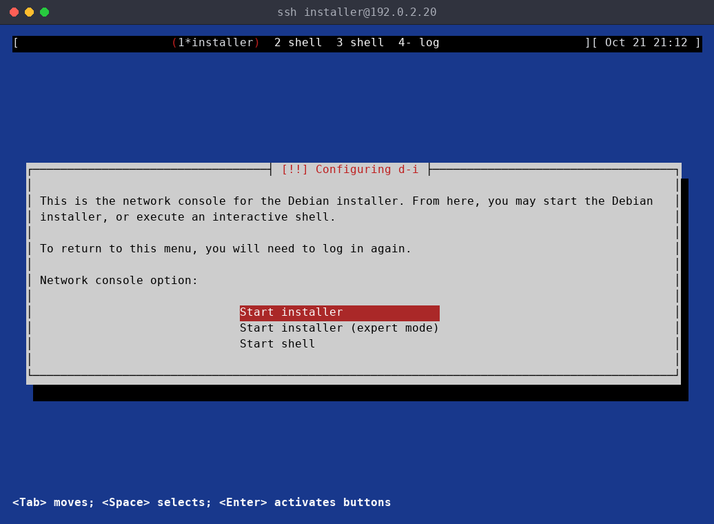
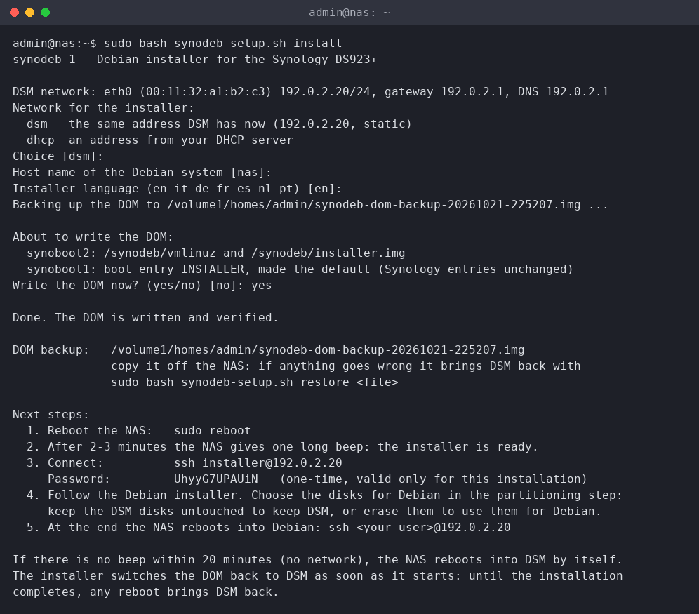

# synodeb

<h3 align="center">
Debian 13 on the Synology DS923+, with every piece of hardware working:<br>
fans, LEDs, buttons, beeper, power schedule, UPS, watchdog, all four bays and both M.2 slots.
</h3>

synodeb turns a **Synology DS923+** into a plain **Debian trixie** server. A Linux
kernel (6.18 LTS, or the newest stable 7.3) with drivers for the DS923+ platform is started by
the NAS's own boot loader, and the official **Debian installer** runs over **SSH**, because the NAS has no screen. You
choose the disks, RAID, LVM and filesystems in the installer, as on any Debian
machine.

DSM can stay: install Debian on a new disk or on the NVMe drives, keep the DSM disks
untouched, and switch between the two with one command.

<p align="center">
  
  
</p>

> [!WARNING]
> synodeb works: it runs on the author's own DS923+, and every feature below was tested
> there on the real hardware. Still, replacing the operating system of a NAS is risky. **You use
> it at your own risk**: make a backup of your data first, and keep the DOM backup that the
> setup script makes.

This project is not affiliated with, endorsed or supported by Synology Inc. "Synology",
"DiskStation" and "DSM" are trademarks of Synology Inc.

## What works

Tested on a DS923+ (AMD Ryzen R1600) with Debian 13 trixie and the synodeb kernel 7.3; the
6.18 longterm kernel carries the same patches.
Please report problems in the [issues](https://github.com/rylos/synodeb/issues); questions and
ideas go to the [discussions](https://github.com/rylos/synodeb/discussions).

| | |
|---|---|
| **Boot** | from the internal DOM through the Synology boot loader; DSM stays bootable |
| **Disks** | 4 SATA bays with DSM-style staggered spin-up and hot-plug; JMB585 PHY tuning, 6 Gb/s links; per-bay activity LEDs |
| **M.2** | both NVMe slots, with the DSM power limit and APST power saving |
| **Network** | both onboard 1 GbE ports; the optional E10G22-T1-Mini 10 GbE card |
| **Front panel** | power and status LEDs, beeper, power button (clean shutdown), reset button |
| **Fans** | the DSM fan curves (temperature of CPU and disks), speed monitoring, fan failure alerts |
| **Power** | power off and reboot through the microcontroller, power on after an AC loss, scheduled power on (RTC alarm) |
| **UPS** | USB UPS through NUT, with a DSM-like Safe Mode and automatic restart when power is back; optional network UPS server |
| **Watchdog** | hardware watchdog (ACPI WDAT); automatic reboot after a kernel panic |
| **Kernel updates** | from the synodeb apt repository; a new kernel that does not boot falls back to the previous one by itself |
| **Notifications** | e-mail, Telegram or ntfy for SMART, RAID, fans, UPS, failed services, unclean shutdowns |
| **DSM data** | read-only access to DSM volumes (mdadm, LVM, btrfs with the Synology extensions), e.g. to copy the data over |

## Quick start



You need a DS923+ running DSM 7, SSH enabled in DSM (*Control Panel → Terminal & SNMP*) and an
administrator account. The installer downloads Debian from the internet.

1. **Back up your data.** If you plan to erase the DSM disks, make sure nothing on them is
   still needed.
2. **On DSM**, over SSH, download and run the setup script:

   ```sh
   curl -fsSLO https://raw.githubusercontent.com/rylos/synodeb/main/synodeb-setup.sh
   sudo bash synodeb-setup.sh install
   ```

   It asks for the network (`dsm` or `dhcp`), the host name and the installer language,
   backs up the DOM, asks before writing it, adds the Debian installer to it and prints how to
   connect, including a one-time password. **Copy the DOM backup off the NAS.**

   While it writes the DOM the script ignores a dropped SSH session and Ctrl-C, but a
   session that drops earlier stops it. On an unreliable connection run it under `screen` or
   `tmux` if you have them, or detached:
   `sudo nohup bash synodeb-setup.sh install --yes > setup.log 2>&1` (add `--network`,
   `--hostname`, `--lang` as needed) and read the password in `setup.log`.
3. **Reboot** the NAS (`sudo reboot`). After 2-3 minutes it gives **one long beep**: the
   installer is ready.
4. **Connect** with the command and password the script printed:

   ```sh
   ssh installer@192.168.1.20
   ```

   Choose *Start installer* and follow the Debian installer. In *Partition disks* select
   where Debian goes (see [Keeping DSM](#keeping-dsm)); do not choose *encrypted LVM*, an
   encrypted root cannot be unlocked at boot. The DOM (the 128 MB disk with two small
   partitions) is shown as installation media and locked: leave it alone, the NAS cannot
   boot without it. The SSH session stays up for the
   whole installation; if it drops, connect again and the installer is where you left it.
5. At the end the NAS reboots into Debian. Log in with the user you created:
   `ssh <user>@<address>`. With `--network dsm` Debian keeps the address DSM had; with
   `dhcp` it may get a different one from your DHCP server.

If the installer gets no network within 20 minutes it reboots into DSM by itself, and until
the installation completes any reboot brings DSM back.

If the installer cannot switch the DOM back to DSM when it starts, the status LED turns
orange with three short beeps, and after 20 minutes without SSH there are five short beeps
and no reboot (it would start the installer again). Connect over SSH and complete the
installation, or choose *Execute a shell* and switch the DOM by hand:
`. /usr/lib/synodeb-installer/lib.sh; dom_unprotect; dom_default SYNOLOGY_2; dom_protect`.

## Keeping DSM

DSM lives on its own disks (a small RAID1 system partition on every DSM disk) and on the DOM.
synodeb never changes DSM: it only adds its boot entries and files to the DOM.

To keep DSM, install Debian **on a disk DSM does not use**: an empty disk in a free bay, or an
NVMe drive that is not part of a DSM volume. In the installer's *Partition disks* step choose
*Manual* or *Guided – use entire disk* on that disk only, and leave the DSM disks as they are.
The installer never assembles the DSM RAID arrays, so they cannot be changed by accident, and
it keeps the DOM out of guided partitioning and locks it in manual partitioning: never delete
or format it.

The installed Debian keeps that rule: `/etc/mdadm/mdadm.conf` lists the arrays that exist at
the end of the installation and has `AUTO -all`, so DSM's arrays are never assembled. An
array created later is assembled at boot once its line is added there: copy it from
`sudo mdadm --detail --scan`, then run `sudo update-initramfs -u`.

To use the DSM disks for Debian instead, just select them in the partitioner and let it erase
them: DSM and its data on those disks are gone.

**Switching between Debian and DSM**

| from | to | command |
|---|---|---|
| Debian | DSM | `sudo synodeb-dom default dsm && sudo reboot` |
| DSM | Debian | `sudo bash synodeb-setup.sh boot debian && sudo reboot` |
| Debian | Debian, previous kernel | `sudo synodeb-dom default debian-old && sudo reboot` |

The choice stays until it is changed again. From DSM, `sudo bash synodeb-setup.sh boot dsm`
also works.

## synodeb-setup.sh

Runs on DSM, as root. Without arguments it shows a menu; every entry is also a command.

| command | what it does |
|---|---|
| `install` | backs up the DOM and adds the Debian installer to it, made the default boot entry; the kernel of an installed Debian stays on the DOM (see `--replace-debian`) |
| `boot debian` | makes the installed Debian the default boot entry |
| `boot dsm` | makes DSM the default boot entry |
| `status` | shows the boot entries, the default one and the files of synodeb on the DOM |
| `cancel` | removes the installer from the DOM; DSM boots (an installed Debian stays: `boot debian` makes it the default again) |
| `restore FILE` | writes a DOM backup back, byte for byte, and verifies it; works on a damaged DOM too |
| `uninstall` | advanced: removes everything synodeb put on the DOM (boot entries, kernels, installer, markers) and puts the original Synology boot configuration back |

Options of `install`:

| option | default | |
|---|---|---|
| `--network dsm\|dhcp` | asked (`dsm`, or `dhcp` if DSM uses DHCP) | `dsm`: the installer uses the address DSM has now, as a static address; `dhcp`: an address from the DHCP server. With a DSM bond or Open vSwitch the installer uses one port only, without link aggregation |
| `--hostname NAME` | asked (DSM host name) | host name of the Debian system: letters, digits and `-` |
| `--lang en\|it\|de\|fr\|es\|nl\|pt` | asked (`en`) | language and keyboard layout of the installer |
| `--backup-dir DIR` | current folder | where the DOM backup goes |
| `--yes` | | no questions, defaults for everything not given |
| `--local DIR` | | take `vmlinuz` and `installer.img` from DIR instead of downloading them |
| `--repo URL` | synodeb repository | apt repository for the installed system (`http://` or `https://`) |
| `--replace-debian` | | when the DOM has no room for the installer next to the kernel of an installed Debian, remove that Debian from the DOM instead of stopping (without it the script asks, even with `--yes`) |

Options can come before or after the command.

Every write to the DOM works on a copy: the copy is checked, the partition is checked to be
unchanged since it was read, then the copy is written back with `dd`, read back from the
device and compared. If a write fails, what was there before is written back automatically:
the DOM backup for `install` and `uninstall`, the copy of the partition read before the change
for the other commands. While the DOM is written, a dropped SSH session, Ctrl-C and `kill`
(TERM) are ignored.

The one-time SSH password of the installer is in the INSTALLER boot entry on the DOM (and on
the installer's kernel command line) only: it is removed when the installation completes, by
`cancel` and by `uninstall`. DOM backups are readable by root only.

## On the installed system

| command | |
|---|---|
| `synohwd status` | temperatures, fans, bays, LEDs |
| `synodeb-dom status` | boot entries and kernels on the DOM |
| `synodeb-dom default debian\|debian-old\|dsm` | default boot entry |
| `synodeb-ups status` | UPS and Safe Mode |
| `synodeb-dsm` | mount DSM volumes read-only (`synodeb-dsm --help`) |

Configuration:

- `/etc/synohwd.toml`: fan curves, beeper, power on after AC loss, Wake-on-LAN.
- `/etc/synodeb/notify.conf`: notifications (SMTP, Telegram, ntfy). Nothing is sent until a
  channel is configured.
- `/etc/synodeb/ups.conf`: UPS behaviour, see [UPS](#ups).
- `/etc/default/synodeb`: extra kernel parameters (run `synodeb-dom setup` after a change).

**UPS.** <a id="ups"></a>A USB UPS works like on DSM: when its battery runs low the NAS enters
*Safe Mode* (services stopped, volumes unmounted, disks in standby) instead of powering off,
and reboots by itself when mains power is back.

- **Connected during the installation**: nothing to do, NUT is set up and enabled.
- **Connected later**: plug it in and run `sudo synodeb-ups setup --keep-password`.
- **Check**: `synodeb-ups status` (or `upsc ups@localhost`).
- **Other machines using this UPS** (Home Assistant, another NAS, a PC with NUT): put their
  addresses in `/etc/synodeb/ups.conf`, set the password of the NUT user `monuser` and apply:

  ```sh
  sudo nano /etc/synodeb/ups.conf          # NETWORK_CLIENTS="192.168.1.10 192.168.1.11"
  sudo synodeb-ups passwd                  # password of monuser (e.g. the one DSM used)
  sudo synodeb-ups setup --keep-password
  sudo systemctl restart synodeb-nut-firewall nut-server
  ```

  The clients connect to port 3493 with UPS name `ups`, user `monuser` and that password; only
  the listed addresses are allowed. A client that was set up for DSM keeps working once the
  password is the same.
- Other options in the same file: dry run (`DRYRUN=1`, Safe Mode only logged), what to do when
  the UPS stops answering (`NOCOMM_SAFEMODE`), powering the UPS off at the end (`SAFESHUTDOWN`).

**Kernel updates.** The kernel and `synology-ds923` come from the synodeb apt repository and
are updated with `sudo apt update && sudo apt full-upgrade` (a new kernel is a new package, as
with Debian's own kernels), then a reboot. New releases of the kernel series are built and
published automatically, usually within a day of their release on kernel.org. Debian's own security updates are installed
automatically; the kernel never is, because a kernel update writes the DOM. The DOM keeps two kernels: if the new one does not boot, the next boot starts the
previous one and you get a notification. A normal boot never writes the DOM.

**Kernel headers.** For DKMS modules or anything built against the kernel install
`linux-headers-ds923` (or `linux-headers-ds923-stable`): it follows the kernel of its series. Module
signatures are checked but not enforced, so modules built locally load.

**Kernel series.** There are two, named as on [kernel.org](https://www.kernel.org/category/releases.html):

| Metapackage | Series | |
|---|---|---|
| `linux-image-ds923-longterm` | longterm (6.18.y), fixes until December 2028 | **default**, also installed as `linux-image-ds923` |
| `linux-image-ds923-stable` | the newest stable branch (7.3.y, then 7.4.y…) | newer features, each branch maintained for a few months only |

To follow the stable series: `sudo apt install linux-image-ds923-stable` (plus
`linux-headers-ds923-stable` if you build modules). With both installed, the DOM boots the newest
stable kernel; remove `linux-image-ds923-stable` to go back to longterm. Systems installed
before the split (kernel 7.3.0-1) move to longterm with the next `full-upgrade`; the 7.3 kernel
stays as the fallback until it is removed.

RAID arrays created by a 7.x kernel (the synodeb installer before the split used 7.3) record their
logical block size in the md superblock, and a stock 6.18 kernel refuses to assemble them. The
synodeb longterm kernel carries a small patch that reads and keeps that field, so these arrays
work with both series. Moving such disks to another machine needs a kernel newer than 6.18 there.

## How it works

The DS923+ firmware always boots the **DOM**, a 128 MB USB flash module on the mainboard
that holds the Synology boot loader (GRUB) and the DSM kernel. synodeb adds two entries to its
boot menu, *DEBIAN* and *DEBIAN_OLD*, and copies the Debian kernel and initrd next to the DSM
ones. Everything else, the whole Debian system, is on the disks you choose.

The kernel is a kernel.org release (6.18 longterm or 7.3 stable) with Debian's configuration of
that branch and a few additions for the DS923+:

- a platform driver for bay power and presence, USB power, fan speed sensors and the power-off
  and reboot sequence of the front-panel microcontroller;
- the driver for the ATmega1608 that drives the bay LEDs;
- JMB585 SATA PHY tuning, the S-35390A RTC alarm on the power-on line, per-port ATA LED
  triggers;
- read-only mounting of btrfs volumes written by DSM;
- longterm only: md superblocks written by newer kernels (logical block size) are accepted.

`synohwd` (Python) talks to the front-panel microcontroller: fans, LEDs, buttons, beeper,
power-on settings.

The installer is the official Debian netboot installer with the kernel modules replaced by
those of the synodeb kernel, a preseed for the steps that run before SSH (language, network,
mirror) and a final step that installs the synodeb kernel and package and writes the DOM.

## Building

Everything builds in `debian:trixie` containers (Docker).

```sh
kernel/run-build.sh          # kernel .deb packages, longterm series (kernel/longterm/VERSION)
SERIES=stable kernel/run-build.sh   # stable series (kernel/stable/VERSION)
installer/run-build.sh       # build/out/installer: vmlinuz, installer.img (longterm kernel)
tools/publish.sh             # apt repository and installer for GitHub Pages (build/pages);
                             # SERIES=stable publishes the stable kernel packages
tests/run-test-setup.sh DOM.img   # synodeb-setup.sh against a copy of a DOM image
```

Each series has its `kernel/<series>/VERSION` (upstream version and ABI); patches and Debian
configuration are per branch, in `kernel/patches/<x.y>` and `kernel/config-debian-<x.y>`.

The GitHub workflow [`kernel`](.github/workflows/kernel.yml) checks kernel.org every day for both
series: when a new release of a branch is out it bumps the version and ABI, builds the kernel,
adds it to the signed apt repository and commits the new `VERSION`. When kernel.org has a newer
branch (a new longterm, or the next stable x.y) it only warns: moving to it means porting the
patches. It can also be started by hand (one series or both, rebuild with a new ABI, rebuild the
installer, or build only).

## Known limitations

- **No root on an encrypted volume**: unlocking it at boot would need a console. Encrypt data
  volumes instead (with a key file on the root filesystem).
- **ZFS** only with the longterm kernel (`zfs-dkms` with `linux-headers-ds923`): OpenZFS does
  not support Linux 7.3 yet. btrfs, mdadm, LVM, XFS and ext4 work with both.
- The installer and the system are reached over the network only. The internal serial port
  shows the boot menu and the console, for debugging: see [docs/serial.md](docs/serial.md).
- Only the DS923+ is supported. Support for more models is being planned in
  [#7](https://github.com/rylos/synodeb/discussions/7).

## Related projects

- [abb-agent](https://github.com/rylos/abb-agent): an agent for Synology Active Backup for
  Business that runs on any Linux distribution and kernel and backs up btrfs and ext4 systems
  to a Synology NAS, with no kernel module to build.

## Support the project

synodeb is developed in spare time on the author's own NAS. Supporting other Synology models
(DS723+, DS1522+, DS224+, DS423+…) needs the hardware to test on: donations go towards that.
If you own another model and would like to port synodeb to it, see the plan in
[#7](https://github.com/rylos/synodeb/discussions/7) and say hello in the
[discussions](https://github.com/rylos/synodeb/discussions/categories/ideas).

## Buy me a beer

If synodeb gave your DS923+ a second life, you can buy me a beer 🍺 at this Ethereum
address:

```
0xF4dd2D015b913E30429974c2b82e15df5b92fB19
```

ETH or any token on Ethereum and on the networks that use the same addresses (Base, Arbitrum,
Optimism, Polygon, BNB Chain…), e.g. USDC or USDT. Thank you!

## License

GPL-2.0-only. See [LICENSE](LICENSE).
