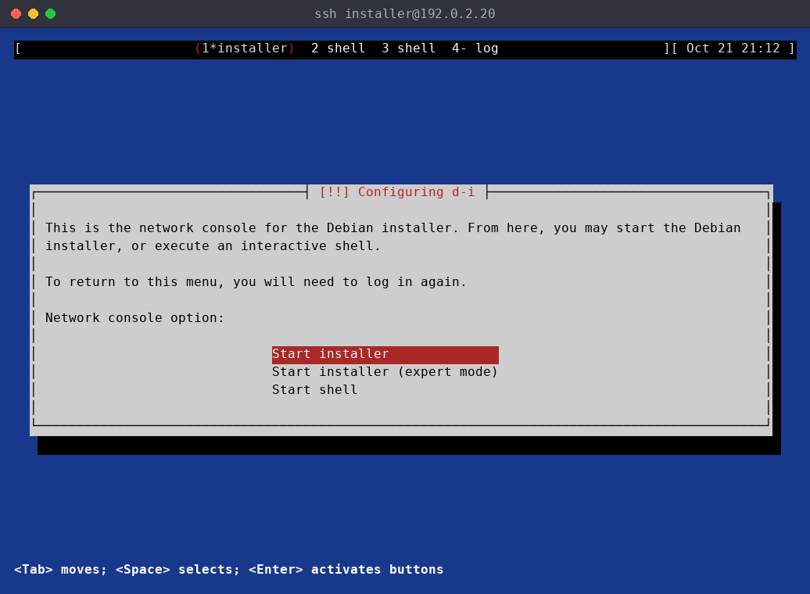

# synodeb

<h3 align="center">
Debian 13 on Synology DS920+ and DS923+, with the NAS hardware working:<br>
fans, LEDs, buttons, beeper, power schedule, UPS, watchdog, every bay and both M.2 slots.
</h3>

synodeb turns a Synology NAS into a plain **Debian trixie** server. A Linux kernel (6.18 LTS,
or the newest stable 7.3) with drivers for the NAS is started by its own boot loader, and the
official **Debian installer** runs over **SSH**. You choose disks, RAID, LVM and filesystems as
on any Debian machine. DSM can stay on its own disks, and one command switches between the two.

<p align="center">
  
  
</p>

> [!WARNING]
> Replacing the operating system of a NAS is risky. **You use synodeb at your own risk**: back
> up your data first, and keep the DOM backup that the setup script makes.

This project is not affiliated with, endorsed or supported by Synology Inc. "Synology",
"DiskStation" and "DSM" are trademarks of Synology Inc.

## Supported models

| model | CPU | status |
|---|---|---|
| **DS923+** | AMD Ryzen R1600 | supported, fully tested |
| **DS920+** | Intel Celeron J4125 | supported ([what was tested](platforms/geminilake/README.md)) |
| DS1522+ | AMD Ryzen R1600 | work in progress |

More models are planned in [#7](https://github.com/rylos/synodeb/discussions/7): if you own one
and want to help, say hello there.

## What works

- **Boot** from the internal DOM through the Synology boot loader; DSM stays bootable.
- **Disks**: every SATA bay with DSM-style staggered spin-up, hot-plug and activity LEDs; both
  NVMe slots with the DSM power limit.
- **Network**: the onboard ports; on the DS923+ also the E10G22-T1-Mini 10 GbE card.
- **Front panel**: power and status LEDs, beeper, power button (clean shutdown), reset button.
- **Fans** on the DSM curves, with failure alerts.
- **Power**: power off and reboot, power on after an AC loss, scheduled power on, hardware
  watchdog.
- **UPS** over USB with a DSM-like Safe Mode; optional network UPS server.
- **Kernel updates** from the synodeb apt repository; a kernel that does not boot falls back to
  the previous one by itself.
- **Notifications** by e-mail, Telegram or ntfy (SMART, RAID, fans, UPS, failed services).
- **DSM volumes** readable from Debian, to copy the data over.
- **Hardware video transcoding** on the DS920+ (Intel iGPU, VA-API/QSV).

## Quick start

You need DSM 7 with SSH enabled (*Control Panel → Terminal & SNMP*), an administrator account
and internet access.

1. **Back up your data.**
2. **On DSM**, over SSH:

   ```sh
   curl -fsSLO https://raw.githubusercontent.com/rylos/synodeb/main/synodeb-setup.sh
   sudo bash synodeb-setup.sh install
   ```

   It backs up the DOM, asks before writing it and prints how to connect to the installer.
   **Copy the DOM backup off the NAS.**
3. **Reboot** (`sudo reboot`). After 2-3 minutes one long beep: the installer is ready.
4. **Connect** with the command and one-time password the script printed, choose
   *Start installer* and install Debian. Leave the DOM (the 128 MB disk) alone; to keep DSM,
   install on a disk DSM does not use.
5. The NAS reboots into Debian: `ssh <user>@<address>`.

Until the installation completes, any reboot brings DSM back. Details, partitioning advice
and troubleshooting: [docs/install.md](docs/install.md).

**Switching:** from Debian `sudo synodeb-dom default dsm && sudo reboot`, from DSM
`sudo bash synodeb-setup.sh boot debian && sudo reboot`.

## Documentation

- [Installation](docs/install.md): steps, choosing disks, keeping DSM, `synodeb-setup.sh`
- [On the installed system](docs/usage.md): commands, configuration, UPS, notifications
- [Kernel](docs/kernel.md): series, updates, headers and DKMS
- [How it works and building](docs/development.md): DOM, drivers, build, CI, models
- [Serial console](docs/serial.md), for debugging
- Hardware notes per platform: [r1000](platforms/r1000/README.md) (DS923+, DS1522+),
  [geminilake](platforms/geminilake/README.md) (DS920+)

## Known limitations

- No root on an encrypted volume (it cannot be unlocked without a console); encrypt data
  volumes instead.
- ZFS only with the longterm kernel.
- Expansion units (DX517 and others): experimental driver, not confirmed on these models.
- The NAS is reached over the network only; the serial console is for debugging.

Problems go to the [issues](https://github.com/rylos/synodeb/issues), questions and ideas to the
[discussions](https://github.com/rylos/synodeb/discussions).

## Related projects

- [abb-agent](https://github.com/rylos/abb-agent): an agent for Synology Active Backup for
  Business that runs on any Linux distribution and kernel, with no kernel module to build.

## Support the project

synodeb is developed in spare time. Supporting more models needs the hardware to test on, and
donations go towards that. You can buy me a beer 🍺 at this Ethereum address (ETH or any token
on Ethereum and on networks with the same addresses: Base, Arbitrum, Optimism, Polygon, BNB
Chain…):

```
0xF4dd2D015b913E30429974c2b82e15df5b92fB19
```

## License

GPL-2.0-only. See [LICENSE](LICENSE).
